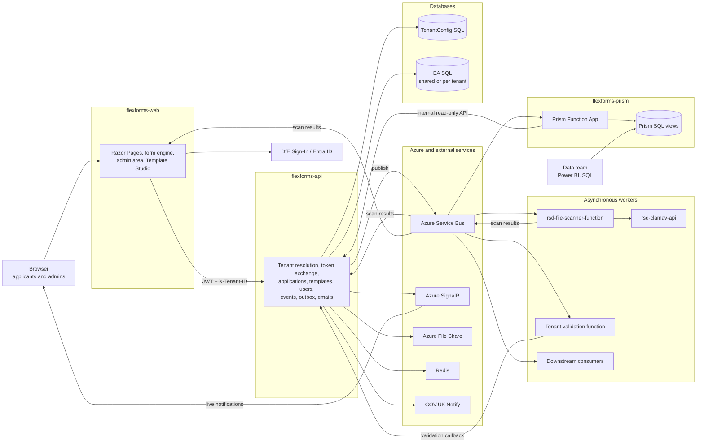
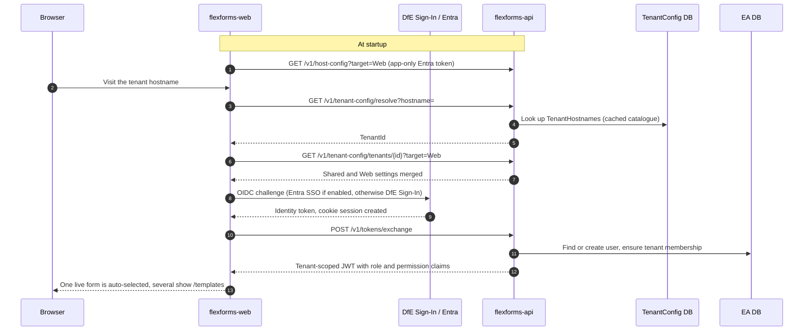
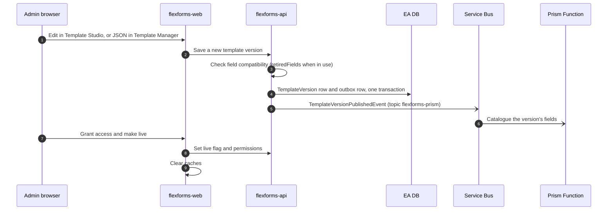
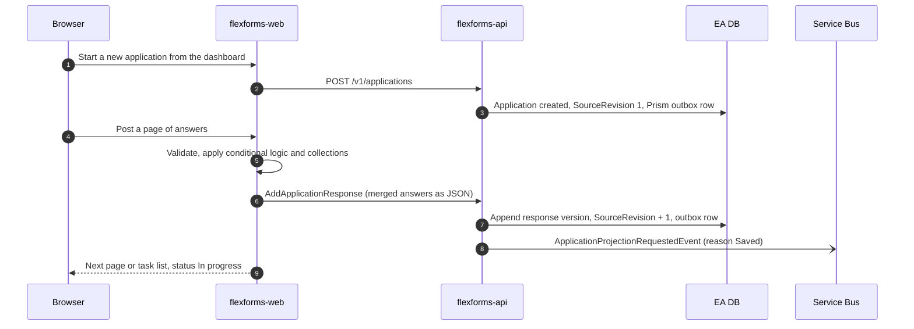
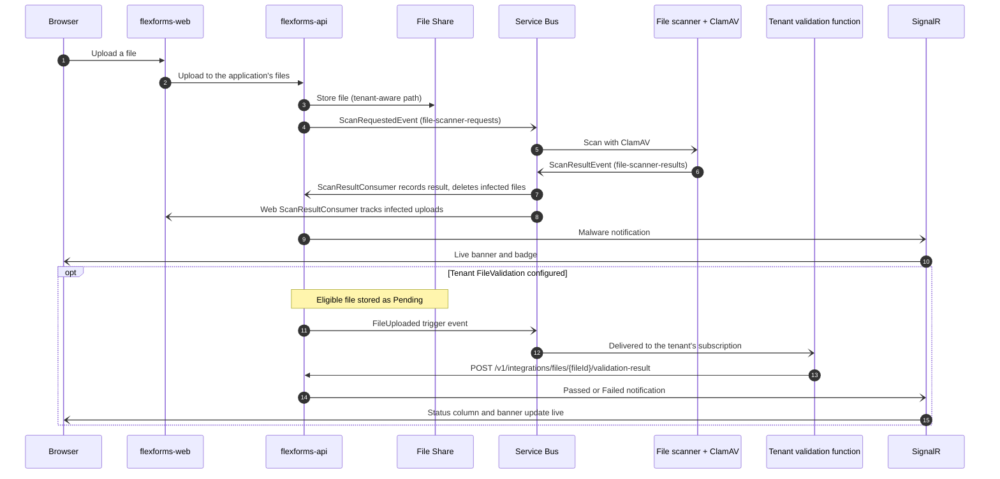
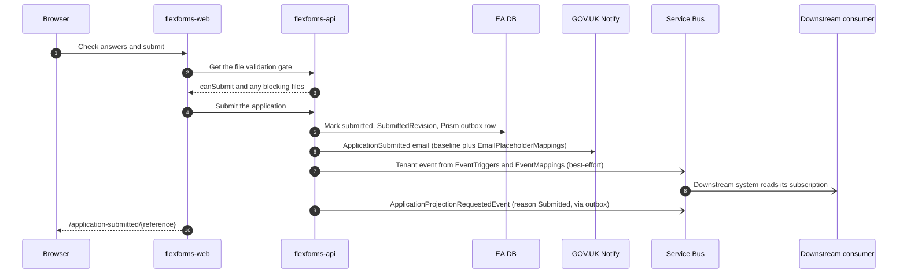
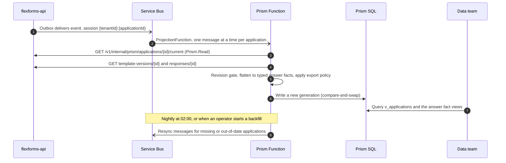

# FlexForms Process Map

How FlexForms works end to end, from two angles:

- **User perspective**: who does what, and in what order, from setting up a tenant to reporting on submitted applications.
- **Technical perspective**: which systems talk to each other, and how, for the six main flows.

FlexForms is a multi-tenant, template-driven GOV.UK form platform. **flexforms-web** renders forms and admin tools, **flexforms-api** owns data, rules and events, and **flexforms-prism** turns applications into rows the data team can report on.

**Related guides**

- [Tenant Admin User Manual](Tenant-Admin-User-Manual.md): creating templates, making them live, giving people access, event mappings.
- [Template Studio User Manual](Template-Studio-User-Manual.md): designing forms visually.
- [Form Template Designer Manual](Form-Template-Designer-Manual.md): the template JSON.
- [flexforms-api README](https://github.com/DFE-Digital/flexforms-api) and [flexforms-prism README](https://github.com/DFE-Digital/flexforms-prism): API and reporting internals.

---

## Contents

1. [User perspective](#1-user-perspective)
   1. [Stages at a glance](#11-stages-at-a-glance)
   2. [Who does what at each stage](#12-who-does-what-at-each-stage)
   3. [Rules people run into](#13-rules-people-run-into)
2. [Technical perspective](#2-technical-perspective)
   1. [Components](#21-components)
   2. [Open the service and sign in](#22-open-the-service-and-sign-in)
   3. [Build and publish a form](#23-build-and-publish-a-form)
   4. [Fill in and save](#24-fill-in-and-save)
   5. [Upload a file](#25-upload-a-file)
   6. [Submit](#26-submit)
   7. [Report through Prism](#27-report-through-prism)
   8. [Design principles behind the flows](#28-design-principles-behind-the-flows)

---

## 1. User perspective

### 1.1 Stages at a glance

Each box names the role that does the step. Solid arrows are the usual order; dotted arrows show configuration that takes effect later.

```mermaid
flowchart LR
    subgraph S1["1. Set up the service"]
        direction TB
        S1a["SuperAdmin<br/>Create tenant: hostnames,<br/>login provider, databases"]
        S1b["SuperAdmin<br/>Assign tenant Admin"]
        S1c["Tenant Admin<br/>Organisation settings and roles"]
        S1a --> S1b --> S1c
    end

    subgraph S2["2. Design the form"]
        direction TB
        S2a["Form designer<br/>Create template (not live)"]
        S2b["Form designer<br/>Sections, tasks, pages,<br/>questions and rules"]
        S2c["Form designer<br/>Preview and save a version"]
        S2a --> S2b --> S2c
    end

    subgraph S3["3. Publish and grant access"]
        direction TB
        S3a["Tenant Admin<br/>Grant form access"]
        S3b["Tenant Admin<br/>Make live"]
        S3c["Tenant Admin<br/>Integrations: event mappings,<br/>email placeholders, file validation"]
        S3a --> S3b
    end

    subgraph S4["4. Apply"]
        direction TB
        S4a["Applicant<br/>Sign in"]
        S4b["Applicant<br/>Choose a form and start"]
        S4c["Applicant<br/>Complete tasks page by page"]
        S4d["Applicant<br/>Upload files"]
        S4e["Applicant<br/>Invite contributors (optional)"]
        S4f["Applicant<br/>Check answers and submit"]
        S4a --> S4b --> S4c --> S4d --> S4e --> S4f
    end

    subgraph S5["5. After submission"]
        direction TB
        S5a["Applicant<br/>Confirmation page and email"]
        S5b["Caseworker<br/>Review applications"]
        S5c["Downstream system<br/>Receives submission event"]
        S5d["Data team<br/>Reports in Power BI"]
    end

    S1c --> S2a
    S2c --> S3a
    S3b --> S4a
    S4f --> S5a
    S4f --> S5b
    S4f --> S5c
    S4f --> S5d
    S3c -.-> S5c
    S3c -.-> S5a
```

### 1.2 Who does what at each stage

| Role | 1. Set up the service | 2. Design the form | 3. Publish and grant access | 4. Apply | 5. After submission |
|------|----------------------|--------------------|-----------------------------|----------|---------------------|
| **SuperAdmin** (platform team) | Create the tenant, hostnames, login provider (DfE Sign-In or Entra) and database connections. Assign the tenant Admin. | | Platform settings: Notify templates, file storage, outbox routing. | | Support: trace issues by ErrorId and correlation id. Audited secret reveal in Production. |
| **Tenant Admin** (service owner) | Organisation settings: terminology, banner, dashboard filters, submitted page. Create custom roles such as Caseworker or Template Manager. | | Grant form access (to all users, or per user). Make the form live. Set up event mappings, email placeholders and file validation. | | Monitor every application for a form. Choose which fields Prism may export. |
| **Form designer** (Template Manager role) | | Create the template (starts not live). Build sections, tasks, pages and questions in Template Studio or JSON. Add rules, validation and repeatable lists. Preview, then save a new version. | Clear caches so users pick up the new version. | | |
| **Applicant** (and invited contributors) | | | | Sign in on the tenant hostname. Choose a form and start from the dashboard. Complete tasks page by page. Upload files. Invite contributors if the form allows it. Check answers and submit. | Confirmation page and GOV.UK Notify email. Live notifications for malware and file validation results. |
| **Caseworker** (custom role) | | | | | Review applications (needs `Application:Any:Read`). |
| **Downstream systems and data team** | | | | | Receive a Service Bus message for each configured event. Report from Prism views in Power BI or SQL. |

### 1.3 Rules people run into

| Rule | What it means |
|------|---------------|
| **Saved is not live** | Saving a template version does not publish it. An Admin still has to make the form live and grant access. |
| **Applications keep their version** | People carry on with the version they started. New applications use the latest version. |
| **Changing a form in use needs care** | Once applications exist, a removed or renamed question must be declared in the new version, so answers and reports carry on. |
| **Files can block submit** | Infected files are deleted. Files that fail tenant validation are kept, but can block submit depending on the form's validation mode. |
| **Navigation follows access** | **Forms** appears only with more than one live form. **Admin** and **Applications** appear only with the right role or permission. |

---

## 2. Technical perspective

In the sequence diagrams below:

- Solid arrows (`->>`) are HTTP calls.
- Dotted arrows (`-->>`) are responses.
- Open arrowheads (`-)`) are asynchronous messages over Azure Service Bus or SignalR pushes.

### 2.1 Components

| Component | Responsibilities |
|-----------|------------------|
| **flexforms-web** | Tenant middleware (hostname to tenant config). Sign-in with DfE Sign-In or Entra, cookie sessions, token refresh. Form engine: tasks, pages, rules, collections. Admin area: Template Studio, users, roles, tenant settings, event mappings. Notification centre over SignalR. |
| **flexforms-api** | Tenant resolution and the TenantConfig provider. Token exchange, roles and permission claims. Applications, templates and users (MediatR commands and queries). Event triggers, transactional outbox, GOV.UK Notify emails. Internal read-only endpoints for Prism. |
| **flexforms-prism** | `ProjectionFunction` on Service Bus sessions. Flattener: responses to typed answer facts. Control plane: backfill, reconciliation, export policy. SQL views for Power BI. |
| **File scanning** | `rsd-file-scanner-function` consumes `file-scanner-requests`, scans with `rsd-clamav-api`, publishes to `file-scanner-results`. |
| **Data stores** | TenantConfig SQL: tenants, settings, hostnames, principals. EA SQL (shared or per tenant): users, templates, applications, outbox, temporal audit. Redis cache, Azure File Share, Prism SQL. |
| **Azure and external** | Azure Service Bus (shared, messages stamped with the tenant), Azure SignalR, DfE Sign-In and Entra ID, GOV.UK Notify, Application Insights. |

### 2.2 Open the service and sign in

Every request is bound to a tenant before anything else. The user's identity is then exchanged for a tenant-scoped API token.

- The tenant can also come from the `X-Tenant-ID` header or `?tenantId=` query, which take priority over the hostname.
- The API refreshes its tenant catalogue about every 60 seconds, or on `POST /v1/admin/tenants/refresh`.
- The JWT is sent with `X-Tenant-ID` on every business call. The API rejects a token whose `tenant_id` does not match the request's tenant.

### 2.3 Build and publish a form

Template versions are immutable. Each new version is checked for compatibility with existing answers, stored, and announced to Prism.

- New fields appear as `Unclassified` in `prism.v_template_field_changes`, so the data team can classify them before anyone answers them.
- Making a form live is a separate step from saving a version.

### 2.4 Fill in and save

The Web form engine validates each page. The API appends an immutable response version and increases the application's revision in one transaction.

- The application stays on the template version it was created with.
- The outbox row is committed in the same transaction as the answers, so Prism is never told about a change that rolled back, and never misses one that was saved.

### 2.5 Upload a file

Virus scanning is always on and owned by the platform. Tenant validation is optional and reports back through a callback.

- Failed validation keeps the file but marks it `Failed`. Depending on the form's mode (`FailOnInvalid` or `RequirePassed`), this blocks submit.
- The tenant function authenticates with an API key, Entra client credentials or mTLS. It does not publish onto the FlexForms Service Bus.

### 2.6 Submit

Submit fans out to three places: a confirmation email, an optional tenant integration event, and a guaranteed Prism event.

- Tenant events are either typed CoreLibs events or schema events. A mapping or bus failure does not roll back the submit.
- Email personalisation always includes the baseline keys (name, reference, dates). `EmailPlaceholderMappings` can add values from form answers.

### 2.7 Report through Prism

The event only tells Prism that something changed. Prism reads the real data back from the API, so late, duplicate or out-of-order messages cannot put wrong data into reports.

- A stored projection is only replaced by a higher source revision, so replays end in the same state.
- A submission freezes the exact submitted response, even if the user saves again afterwards.
- A delete writes a tombstone. Superseded generations are cleaned up daily at 03:30.

### 2.8 Design principles behind the flows

| Principle | What it means |
|-----------|---------------|
| **Tenant first** | Hostname or `X-Tenant-ID` picks the tenant before authentication. The token's `tenant_id` must match, or the call is rejected. |
| **Configuration lives in the database** | TenantSettings are stored by category and target (`Shared`, `Api`, `Web`). Secrets are encrypted at rest and redacted in the admin UI. |
| **Guaranteed where it matters** | Prism events always go through the transactional outbox, in the same transaction as the change. Tenant integration events are best-effort. |
| **Events are nudges** | Consumers read state back by revision, so duplicate and out-of-order delivery end in the same result. |
