# Template Studio User Manual

A step-by-step guide to designing application forms with **Template Studio**, the visual way to build and change FlexForms templates without writing JSON.

It is written for anyone who designs or maintains a form: content designers, service owners, tenant administrators and developers. You do not need to know JSON.

**Related guides**

- [Tenant Admin User Manual](Tenant-Admin-User-Manual.md): creating templates, making them live, giving people access.
- [Form Template Designer Manual](Form-Template-Designer-Manual.md): what every part of the template JSON means. Useful if you use the JSON tab.

The screenshots show the **Transfer Applications** template. Your service header, template and wording will look different.

---

## Contents

1. [Before you start](#1-before-you-start)
2. [A tour of Template Studio](#2-a-tour-of-template-studio)
3. [Finding your way around the structure](#3-finding-your-way-around-the-structure)
4. [Template settings](#4-template-settings)
5. [Sections](#5-sections)
6. [Tasks](#6-tasks)
7. [Pages](#7-pages)
8. [Questions](#8-questions)
9. [Repeatable lists](#9-repeatable-lists)
10. [Pages repeated for each item in another list](#10-pages-repeated-for-each-item-in-another-list)
11. [Moving, copying and deleting](#11-moving-copying-and-deleting)
12. [Rules: reacting to earlier answers](#12-rules-reacting-to-earlier-answers)
13. [When applications already use the template](#13-when-applications-already-use-the-template)
14. [Undo and redo](#14-undo-and-redo)
15. [The JSON (advanced) tab](#15-the-json-advanced-tab)
16. [Checking, previewing and saving](#16-checking-previewing-and-saving)
17. [Worked examples](#17-worked-examples)
18. [Keyboard and accessibility tips](#18-keyboard-and-accessibility-tips)
19. [Troubleshooting](#19-troubleshooting)
20. [Glossary](#20-glossary)

---

## 1. Before you start

### 1.1 What Template Studio does

A FlexForms template describes a whole application form: the **sections** on the task list, the **tasks** in each section, the **pages** in each task, and the **questions** on each page. It also holds the **rules** that show or hide pages and questions, and settings such as the dashboard columns.

Template Studio lets you change all of that with forms and buttons. Behind the scenes it writes the template JSON for you. Anything Template Studio doesn't have a form for yet is kept exactly as it is.

### 1.2 Who can use it

You need permission to manage templates: the **Admin** or **SuperAdmin** role, or a role that includes a template **Manage** permission (for example the **Template Manager** role). If you can open **Template Manager**, you can open Template Studio.

### 1.3 Opening Template Studio

1. Go to **Admin**.
2. In **Template Management**, select **Template Manager**.
3. Choose the template and, if you need to, the version you want to start from. Select **Open template** or **Open version**.
4. Select **Open in Template Studio**.

You can also select **Template Studio** on the Admin hub. It opens whichever template you last chose in Template Manager. To edit a different template, choose it in Template Manager first.

### 1.4 What you are editing

Template Studio opens a **copy** of the version you chose. Nothing you do affects applicants until you [save a new version](#163-saving-a-new-version). Even then, the form only changes for applicants once the template is live, which is set on the Admin hub.

- If the template has no versions yet, Template Studio starts from the **starter template**: one section, one task, one page and one question.
- If the template can't be loaded, Template Studio shows an error and doesn't open, so a saved version can't be replaced by mistake.
- Template Studio needs JavaScript. Without it, you can still edit the JSON in Template Manager.

---

## 2. A tour of Template Studio

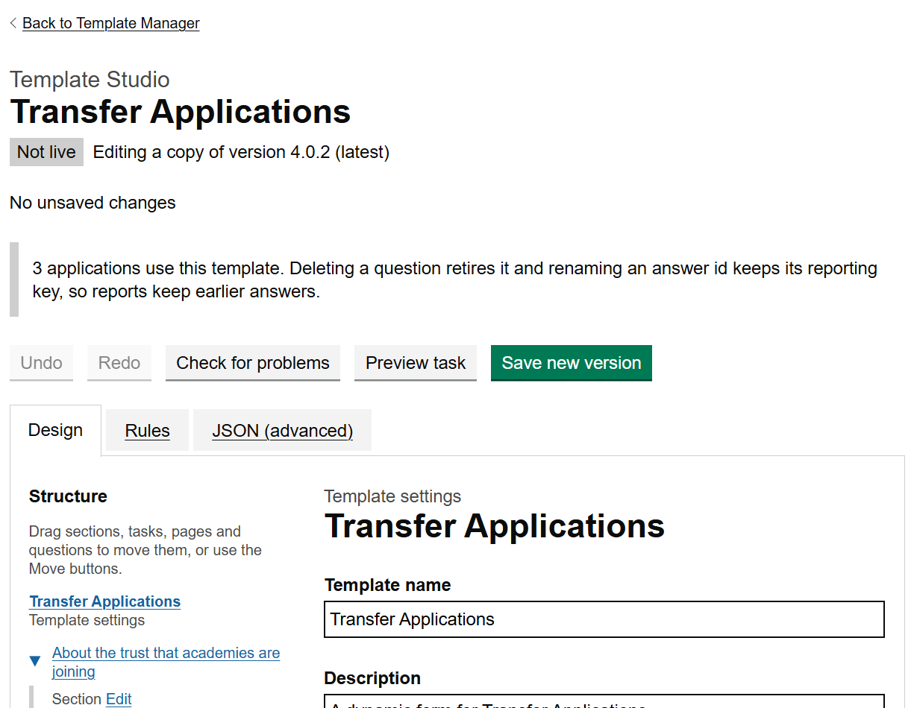

From top to bottom:

| Part | What it tells you or does |
|---|---|
| **Heading** | The template's name, whether it is **Live** or **Not live**, and which version you are editing a copy of. |
| **Status** | **No unsaved changes**, or a yellow **Unsaved changes** tag. |
| **Applications note** | Shown when applications use the template. Explains that deleting and renaming questions is done safely for reporting. See [section 13](#13-when-applications-already-use-the-template). |
| **Undo** and **Redo** | Step back and forward through your changes. See [section 14](#14-undo-and-redo). |
| **Check for problems** | Runs the same checks as saving, without saving. |
| **Preview task** | Opens the task you are working on, as applicants would see it, in a new tab. |
| **Save new version** | Takes you to the save form at the bottom of the page. |
| **Design** tab | The structure on the left and the settings for the selected item on the right. You spend most of your time here. |
| **Rules** tab | Add, change, turn off and delete rules. |
| **JSON (advanced)** tab | The JSON Template Studio writes, for advanced changes. |

Template Studio warns you if you try to leave the page with unsaved changes.

---

## 3. Finding your way around the structure

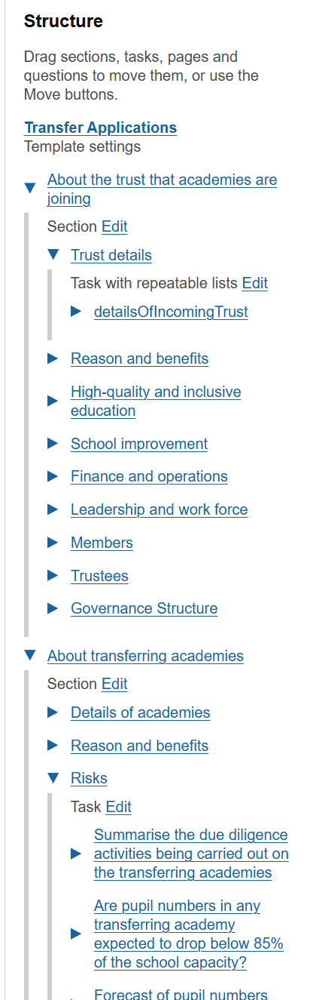

The **Structure** on the left of the Design tab shows the whole template:

- **Template settings** at the top: select the template name to change settings for the whole template.
- **Sections**, **tasks**, **repeatable lists** and **pages** open and close. Select the name (with the arrow) to open or close it.
- Inside each one, **Edit** opens its settings on the right. The second line says what it is, for example "Section" or "Task with repeatable lists".
- **Questions** are listed inside their page. Select a question to open its settings. The grey text under it is its type, with ", optional" if applicants don't have to answer it.
- A yellow **Shown by a rule** tag means a rule shows that page or question. It is hidden until the rule's condition is met.
- The item you are editing is in **bold**.

**Breadcrumbs** above the settings show where the selected item sits, for example *Transfer Applications > About transferring academies > Risks*. Select any of them to go back up.

Each set of settings also lists what is inside the item, each with a **Change** link. For example a task lists its pages, and a page lists its questions.

---

## 4. Template settings

Select the template name at the top of the structure.

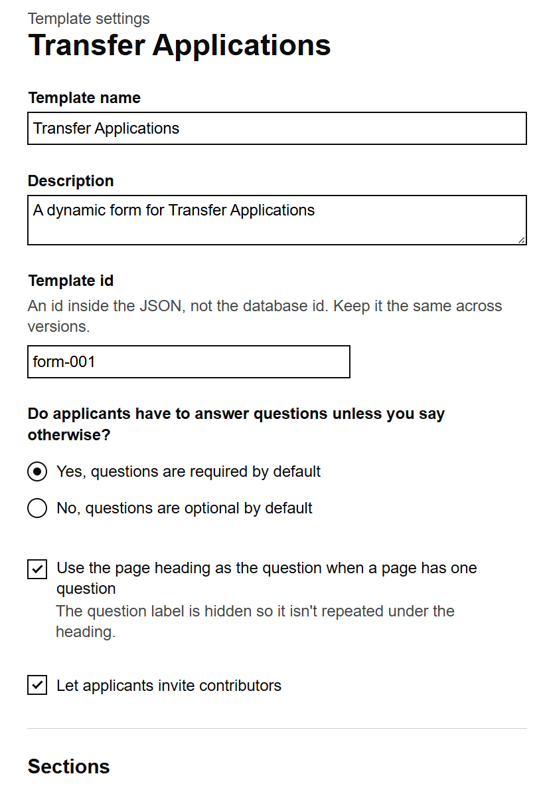

| Setting | What it does |
|---|---|
| **Template name** | The name inside the template. |
| **Description** | A short summary for people maintaining the template. |
| **Template id** | An id inside the JSON (not the database id). Keep it the same across versions. |
| **Do applicants have to answer questions unless you say otherwise?** | The default for questions that don't say whether they must be answered. |
| **Use the page heading as the question when a page has one question** | Hides the question label on single-question pages so it isn't repeated under the heading. |
| **Let applicants invite contributors** | Turns contributor invitations on or off. |

Below these you'll find the list of **Sections** with **Add a section**, then the dashboard columns, task list details and retired questions.

### 4.1 Dashboard columns

The applications dashboard shows default columns until you choose your own.

1. Select **Choose the columns**. The default columns are added so you can change them.
2. Use **Change**, **Move up**, **Move down** and **Remove** on each column.
3. Select **Add a column** to add one, then choose:
   - **An answer**: pick the answer and give the column a heading; or
   - **Something built in**: reference, date started, date submitted, status or action.
4. Select **Done**.

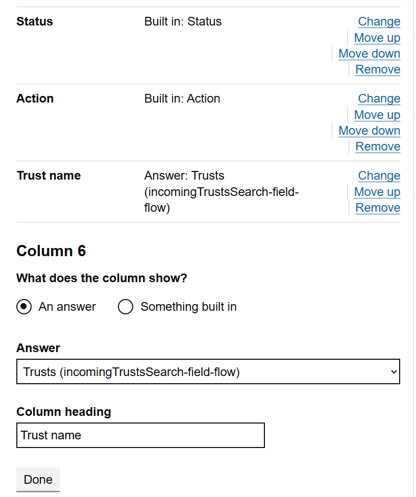

Up to 3 columns can show answers; any more are ignored, and Template Studio warns you. **Use the default columns** goes back to the platform defaults.

### 4.2 Details on the task list

The block under "Your application" on the task list shows default details (reference, version and lead applicant) until you choose your own.

1. Select **Choose the details**.
2. Change, move or remove details, or select **Add a detail**.
3. For each detail, enter a **Label** and choose **What it shows**: an application detail, an answer, or **Something else (enter a path)** for an answer inside a repeatable list, for example `trusts[0].trustSearch.name` for the first trust's name.
4. Select **Done**.

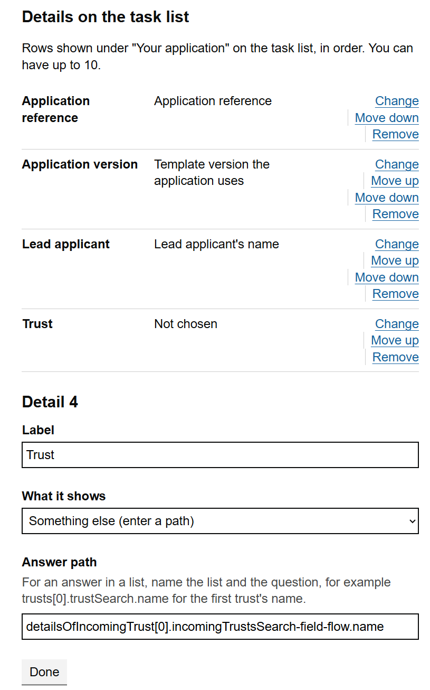

You can have up to 10. **Use the default details** goes back to the platform defaults. Saving checks that every path points at a real answer.

### 4.3 Retired questions

If any questions have been retired (see [section 13](#13-when-applications-already-use-the-template)), they are listed at the bottom with what replaced them.

---

## 5. Sections

Sections are the headings on the task list. Each holds one or more tasks.

**To add a section:** open **Template settings**, enter a **Section heading** under **Add a section**, and select **Add section**.

**To change a section:** select **Edit** next to it in the structure.

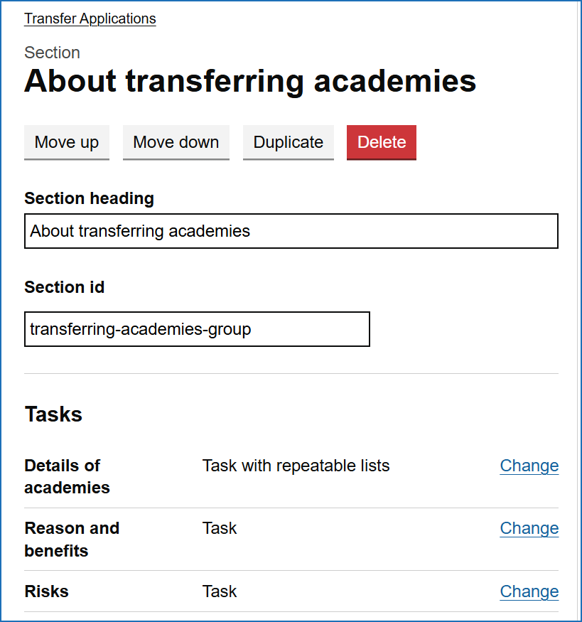

- **Section heading** is what applicants see.
- **Section id** is made from the heading while the section is new. You can change it.
- **Tasks** lists the tasks in the section. A section must have at least one task before you can save.

---

## 6. Tasks

Tasks are the rows applicants select on the task list.

### 6.1 Adding a task

1. Open the section.
2. Under **Add a task**, choose what kind of task it is:
   - **Questions on one or more pages**: the usual kind.
   - **A repeatable list**: applicants add as many items as they need, for example trusts or academies. See [section 9](#9-repeatable-lists).
   - **Pages repeated for each item in another list**: for example a declaration for each trust added earlier. See [section 10](#10-pages-repeated-for-each-item-in-another-list).
3. Enter the **Task name** and select **Add task**.

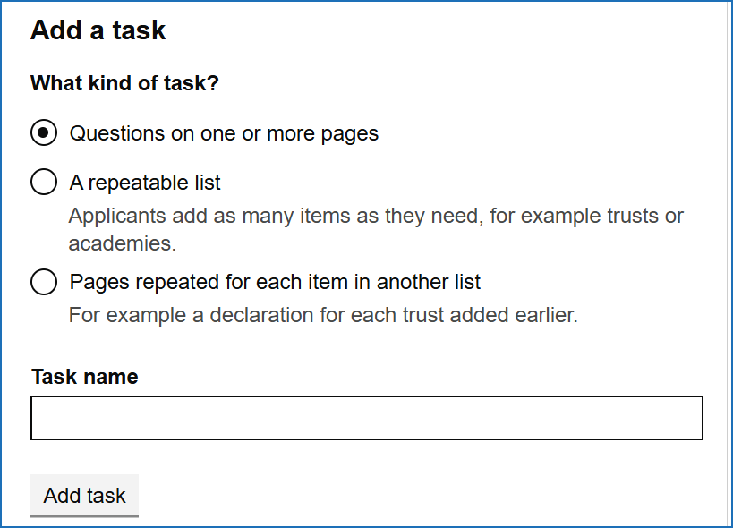

### 6.2 Task settings

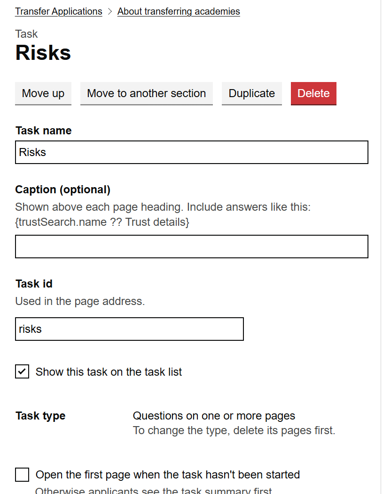

| Setting | What it does |
|---|---|
| **Task name** | Shown on the task list. |
| **Caption (optional)** | Shown above each page heading in the task. Include answers in curly brackets, for example `{trustSearch.name ?? Trust details}`, where the text after `??` is used when there is no answer yet. |
| **Task id** | Used in the page address. |
| **Show this task on the task list** | Untick to hide the task. |
| **Task type** | You can change the type while the task has no pages. Once it has pages, the type is shown with a reminder to delete its pages first. |
| **Open the first page when the task hasn't been started** | Otherwise applicants see the task summary first. Only for tasks with pages. |

While a task has no pages, you can change its type:

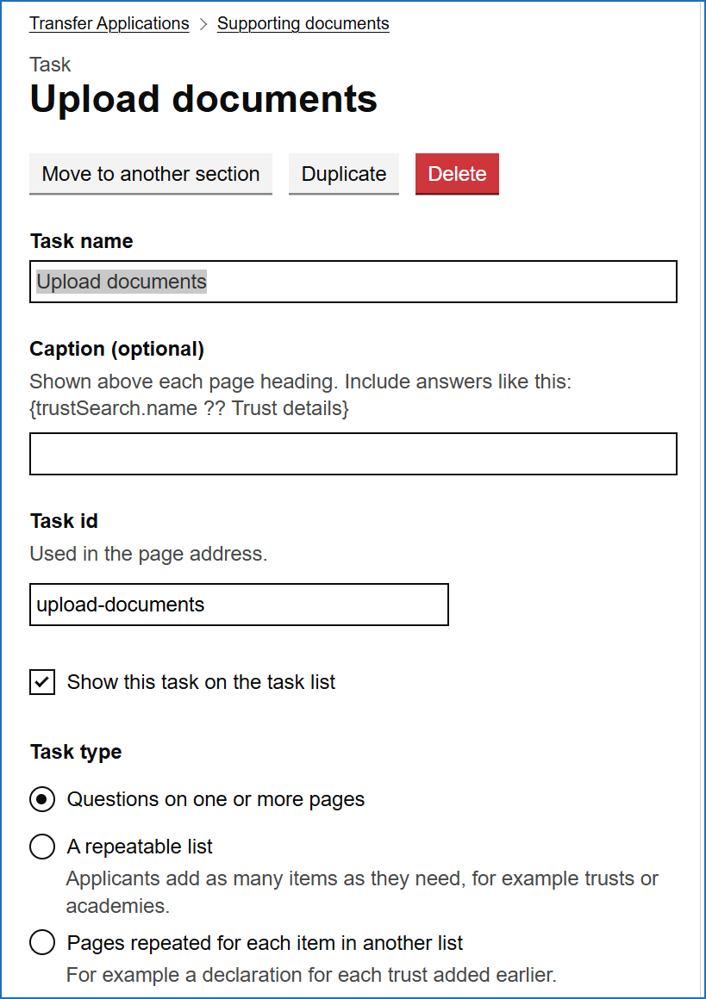

### 6.3 A task's pages

The task lists its pages, each with **Change**. Under **Add a page**, enter a **Page heading** and select **Add page**.

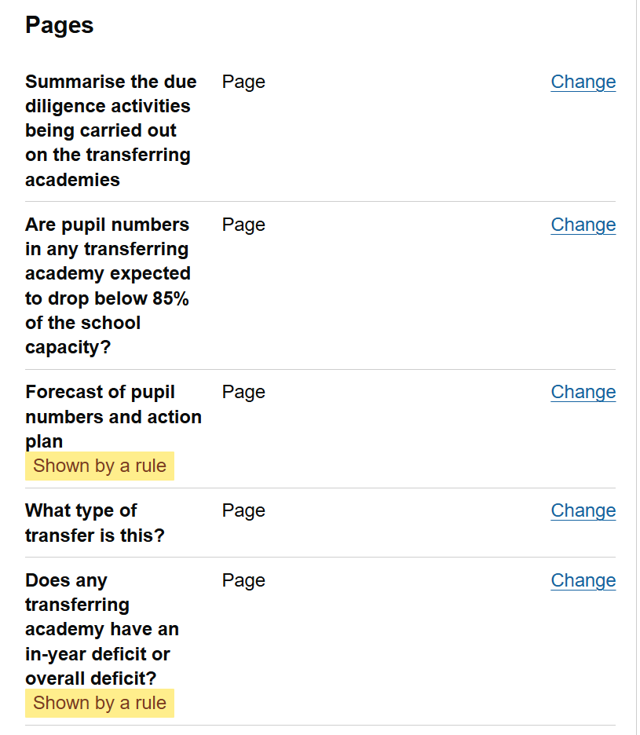

---

## 7. Pages

A page is one screen in the form.

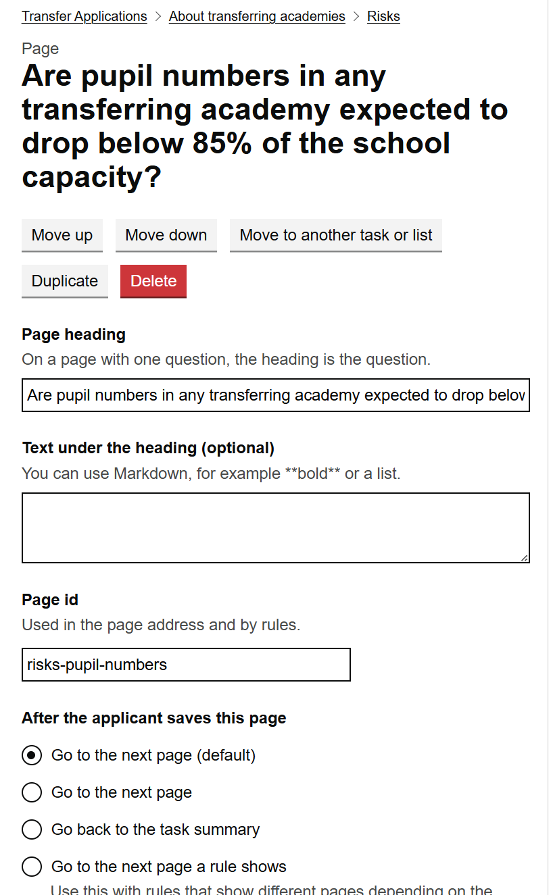

| Setting | What it does |
|---|---|
| **Page heading** | The main heading. On a page with one question, it is also the question. |
| **Text under the heading (optional)** | Extra information. You can use Markdown, for example `**bold**` or a list. |
| **Page id** | Used in the page address and by rules. |
| **After the applicant saves this page** | **Go to the next page**, **Go back to the task summary**, **Go to the next page a rule shows** (for pages that branch, see [section 12.6](#126-branching-pages)), or the default. |
| **Button text (optional)** | Leave blank for "Save and continue". |

### 7.1 Adding a question

1. Open the page.
2. Under **Add a question**, choose the **Question type**.
3. Enter the **Question**. On a page with no questions yet, you can leave it blank to use the page heading.
4. Select **Add question**.

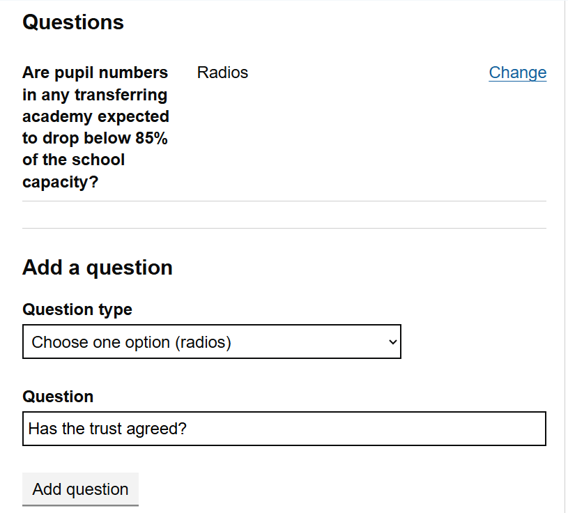

New questions are set so applicants **must answer them**, with a suitable error message. You can change both.

### 7.2 Rules on a page

At the bottom of a page's settings, **Rules** lists the rules that use the page. **Add a rule that shows this page** starts a rule with this page already chosen. See [section 12](#12-rules-reacting-to-earlier-answers).

---

## 8. Questions

Select a question in the structure, or **Change** next to it in its page's list.

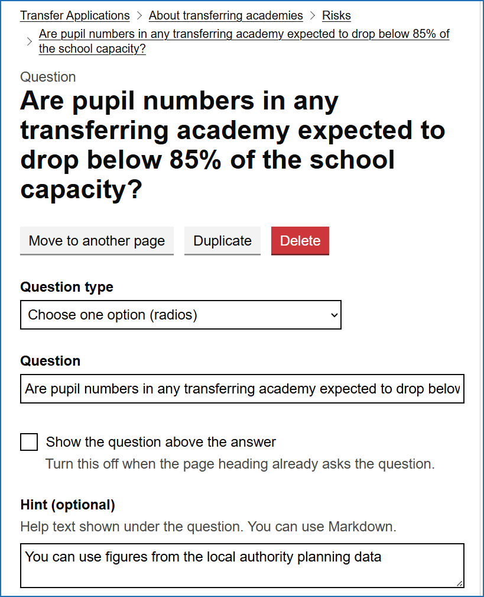

### 8.1 Question types

| Type | What applicants see |
|---|---|
| **Short answer** | A one-line text box. |
| **Email address** | A text box; the answer must be an email address. |
| **Long answer** | A multi-line text box. |
| **Long answer with a character or word limit** | A multi-line box that counts down what's left. Set the limit in **Length limit**. |
| **Choose one option (radios)** | Radio buttons. |
| **Choose one or more options (checkboxes)** | Checkboxes. |
| **Choose one option from a dropdown** | A dropdown list. |
| **Date** | Day, month and year boxes. |
| **Search and select** | Search for something, for example a trust or school, from another service. |
| **File upload** | Upload one or more files. |

Changing the type keeps the wording. Options are added when you change to a choice type, and removed when you change away.

### 8.2 Wording

- **Question**: the question text. While the question is new, its answer id is made from it.
- **Show the question above the answer**: untick when the page heading already asks the question.
- **Hint (optional)**: help text under the question. You can use Markdown.

### 8.3 Answer id and reporting key

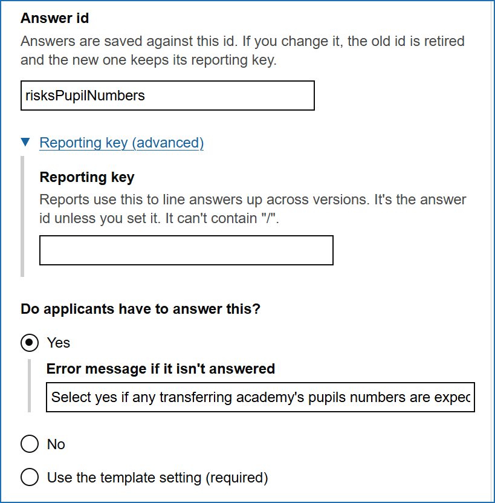

- **Answer id** is what the applicant's answer is saved against. It is also how rules and reports refer to the question.
  - If you change it, rules that use it are updated for you.
  - If applications already use the template, changing it is done safely for reports. See [section 13.3](#133-renaming-an-answer-id).
- **Reporting key (advanced)** lines answers up across versions in reports. It is the answer id unless you set it. You normally only need it when renaming a question; Template Studio sets it for you then.

### 8.4 Whether applicants must answer

**Do applicants have to answer this?**

- **Yes**: enter the **Error message if it isn't answered**.
- **No**.
- **Use the template setting**: follows [Template settings](#4-template-settings).

This can't depend on another answer. To ask a question only sometimes, use a [rule](#12-rules-reacting-to-earlier-answers) to show it.

### 8.5 Options (radios, checkboxes and dropdowns)

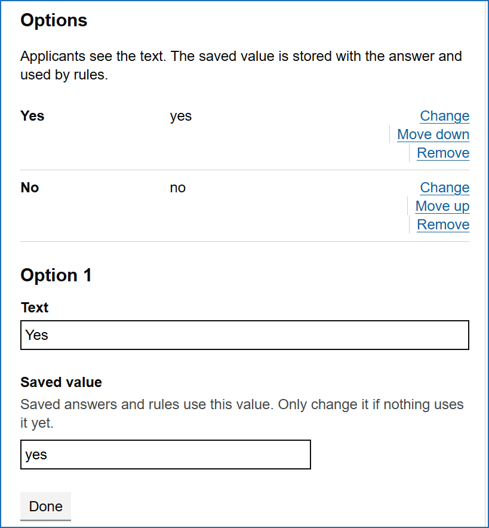

Each option has:

- **Text**: what applicants see.
- **Saved value**: what is stored with the answer and used by rules.

Use **Change**, **Move up**, **Move down** and **Remove**, or **Add an option**. Select **Done** when you have finished changing an option.

For new options, the saved value follows the text as you type. For existing options it stays the same, because saved answers and rules already use it. Only change an existing saved value if nothing uses it yet.

### 8.6 Dates

**Name used in error messages**: for example "Date signed" gives "Date signed must include a month".

### 8.7 Search and upload questions

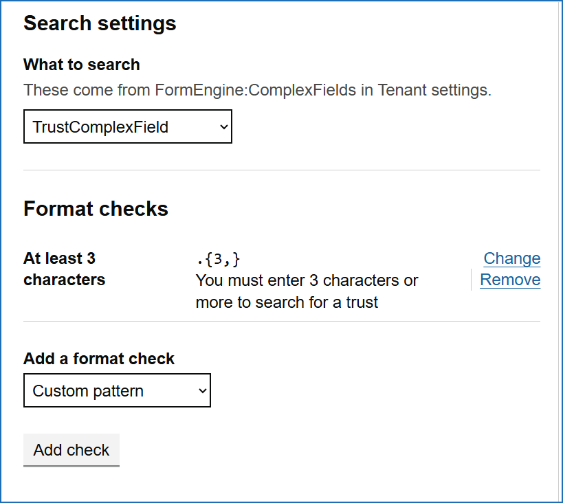

Choose **What to search** (or which **Upload field** to use) from the search and upload fields set up for your organisation, under `FormEngine:ComplexFields` in Tenant settings. If the question uses one that isn't set up, a warning tells you; applicants would see an error until it is added.

**How results are shown (optional)**, for search questions only, changes how this question shows its results without changing the tenant's setting for other questions:

- **Each search result**: how each match in the list looks.
- **The "Is this the right one?" box**: what applicants check before they confirm. This replaces the whole box.
- **The answer on summary pages**: how the chosen result looks when applicants check their answers.

Join the result's properties and your own text with `+`, for example `name + " (" + ukprn + ")"`. You can use Markdown, such as `**` for bold. The hint under each box shows what the tenant uses now. Leave a box blank to keep the tenant's layout.

### 8.8 Length limits

For short answers, email, long answers and long answers with a limit.

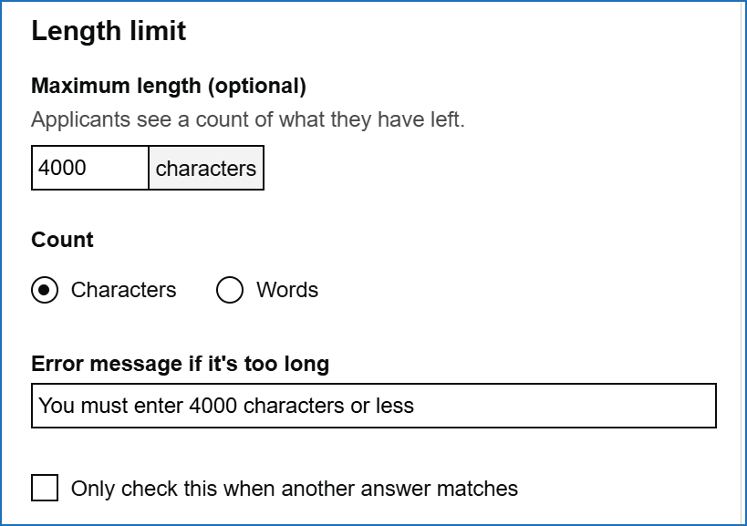

1. Enter the **Maximum length** and press Tab (or select elsewhere).
2. Choose whether to **Count** characters or words.
3. Change the **Error message if it's too long** if you want to.

Clear the number to remove the limit.

### 8.9 Format checks

Format checks make sure an answer matches a pattern, for example a phone number.

1. Under **Add a format check**, choose a ready-made check (**UK telephone number**, **UK postcode**, **Whole numbers only**, **At least 3 characters**) or **Custom pattern**.
2. Select **Add check**.
3. Change the **Pattern** (a regular expression) or the **Error message** if you need to.
4. Select **Done**.

### 8.10 Checks that only apply sometimes

A length limit or format check can apply only when another answer matches.

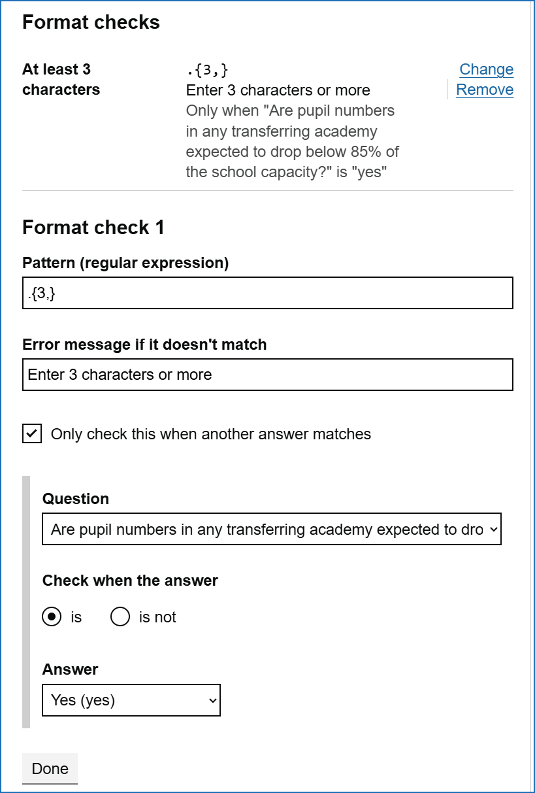

1. Tick **Only check this when another answer matches**.
2. Choose the **Question**, whether the answer **is** or **is not**, and the **Answer**.

The summary shows "Only when … is …" under the check.

### 8.11 More checks and rules

- If a question has checks Template Studio can't show (for example a "required" check with a condition), a note tells you how many are set in the JSON tab.
- **Rules** lists the rules that use the question. **Add a rule that shows this question** starts a rule with this question already chosen.

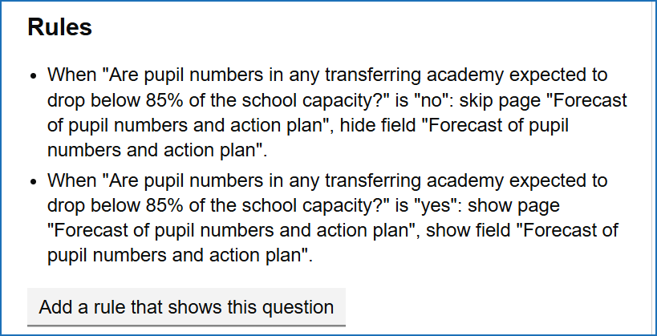

---

## 9. Repeatable lists

A repeatable list lets applicants add as many items as they need, each with its own pages. For example "Add a trust".

**To add one:** add a task of the kind **A repeatable list** (see [6.1](#61-adding-a-task)). It starts with one list. A task can have several lists; open the task and use **Add a repeatable list**.

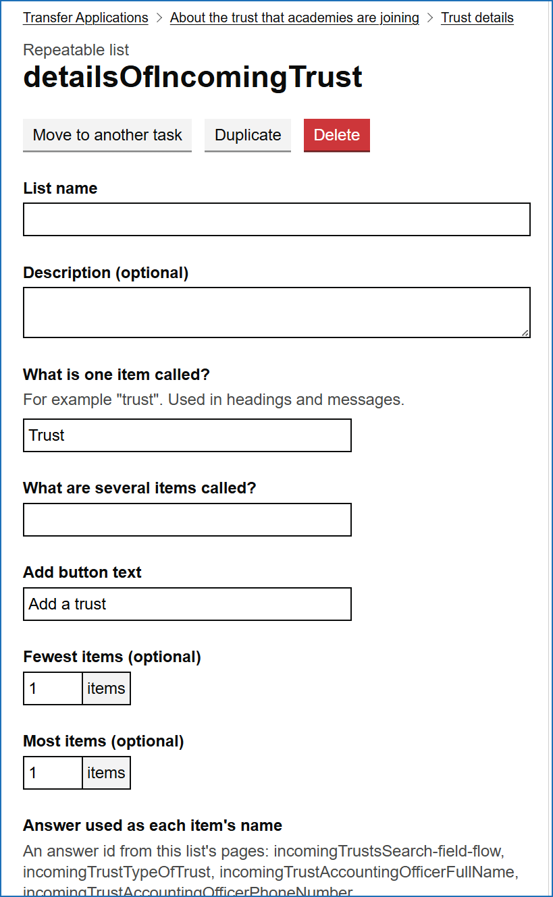

| Setting | What it does |
|---|---|
| **List name** and **Description** | Shown on the list's summary page. |
| **What is one item called?** and **What are several items called?** | For example "trust" and "trusts". Used in headings and messages. |
| **Add button text** | For example "Add a trust". |
| **Fewest items** and **Most items** | Optional limits. |
| **Answer used as each item's name** | The answer id of a question on the list's pages. For a search answer, add the property, for example `trustSearch.name`. |
| **Show added items as** | **Cards** or **A list**. |
| **List id** and **Answer id for the whole list** | Every item is saved under the answer id. |

### 9.1 Columns and messages

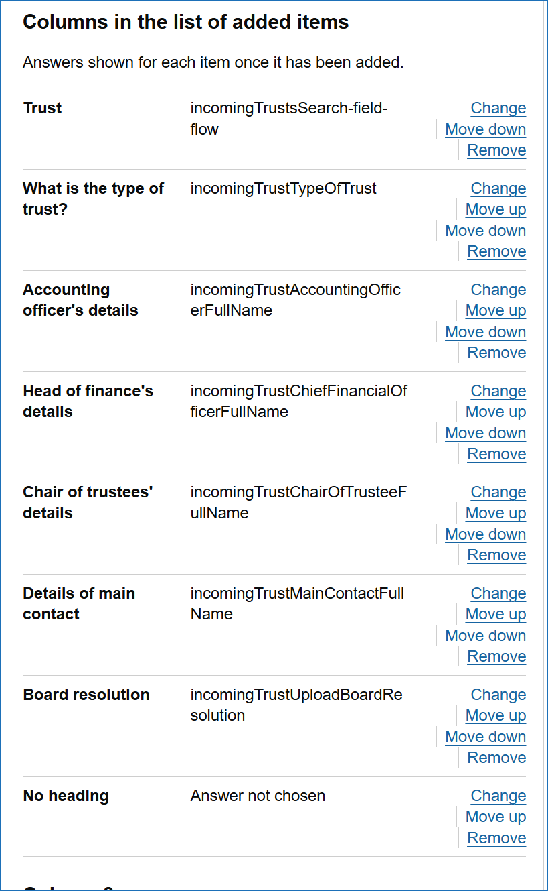

- **Columns in the list of added items**: answers shown for each item once added. Select **Add a column**, enter the **Column heading**, choose the **Answer**, and select **Done**.
- **Messages**: shown after an item is added, changed or removed. Include an answer in curly brackets, for example `{trustSearch.name}`.

### 9.2 Pages for each item

Use **Add a page to each item** to add the pages applicants fill in for every item. Then add questions to those pages as usual.

---

## 10. Pages repeated for each item in another list

These repeat the same pages for every item in an earlier list or answer. For example, a declaration page for each trust added in "Trust details".

**To add one:** add a task of the kind **Pages repeated for each item in another list**. Its settings let you set the **Heading on the task page** and the text under it. Open the repeated pages to set them up:

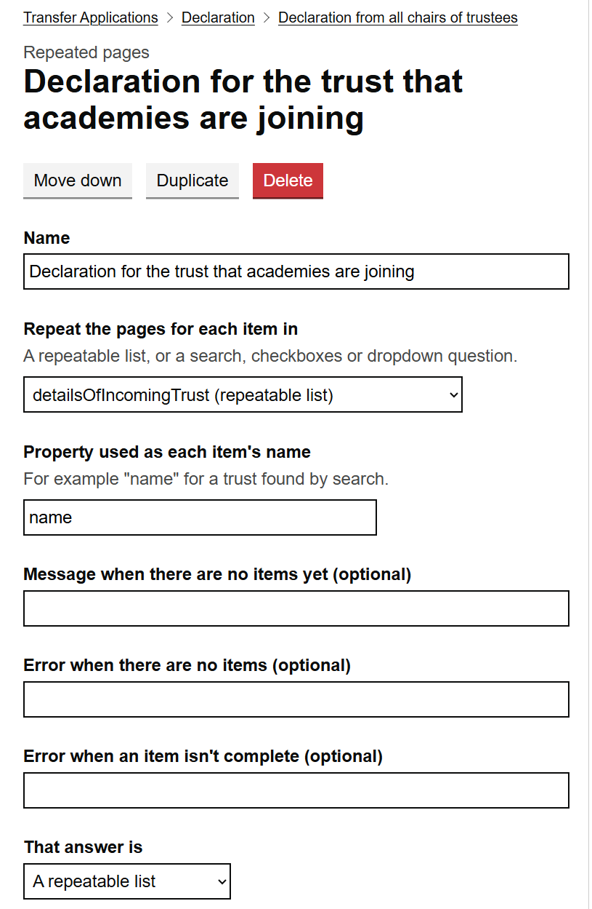

1. **Repeat the pages for each item in**: choose a repeatable list, or a search, checkboxes or dropdown question. **That answer is** is filled in for you.
2. **Property used as each item's name**: for example "name" for a trust found by search.
3. Optionally, enter the messages:
   - **Message when there are no items yet**;
   - **Error when there are no items**;
   - **Error when an item isn't complete**;
   - **Message when an item is complete**: use `{displayName}` for the item's name.
4. Use **Add a page to each item** to add the pages.

If a task has more than one set of repeated pages, applicants see them in the order shown in the structure. Use **Move up** and **Move down** to change it.

---

## 11. Moving, copying and deleting

Every item except Template settings has these buttons under its heading.

### 11.1 Move up and Move down

Moves the item within its list. Order numbers are kept in step for you.

### 11.2 Move to another page, task or section

Moves a question to another page, a page to another task or list, a task to another section, or a list to another task.

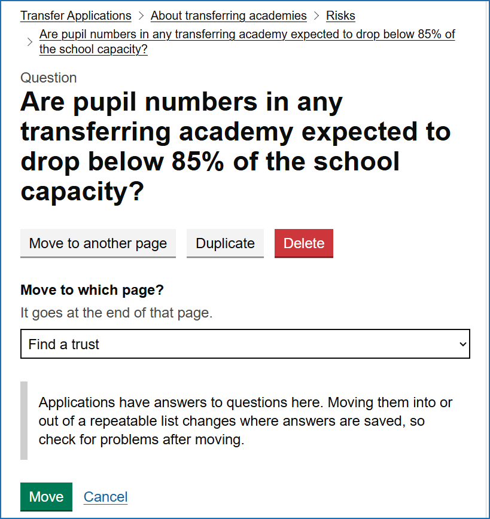

1. Select **Move to another page** (or task, section).
2. Choose where it should go. The choices are grouped by task or section.
3. Select **Move**. It goes at the end.

If applications already have answers, you'll be warned that moving questions into or out of a repeatable list changes where answers are saved. Use **Check for problems** afterwards.

### 11.3 Drag and drop

With a mouse, you can drag items in the structure:

- **Before or after another item of the same kind**: drop it on the top or bottom half of that item. A blue line shows where it will go.
- **Into a container**: drop a question on a page, a page on a task or list, or a task on a section. A yellow outline shows the target, and the item goes at the end.

Drops that don't make sense are refused, for example a question onto a section. If you're not using a mouse, Move up, Move down and Move to do the same.

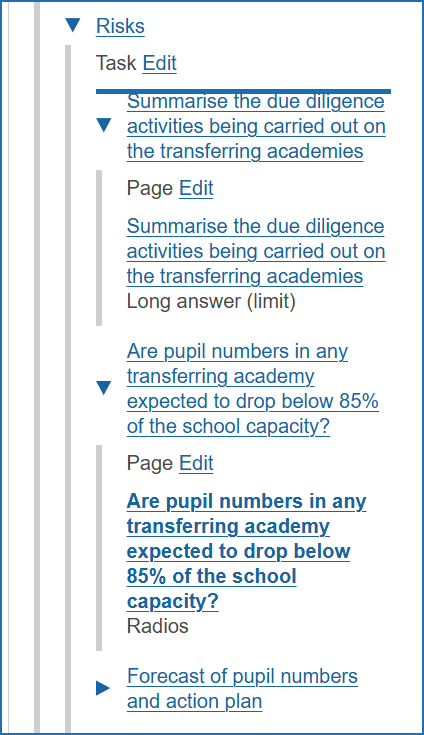

### 11.4 Duplicate

Copies the item and everything in it, with new ids, straight after the original.

### 11.5 Delete

1. Select **Delete**.
2. Read the warning. It says if anything inside will be deleted too, and how many rules use the item.
3. Select **Yes, delete this …**, or **Cancel**.

If applications already have answers to questions being deleted, the warning explains that they will be retired. See [13.2](#132-deleting-questions-applications-have-answered). If event mappings read any of the answers, the warning lists them too. See [13.6](#136-event-mappings).

You can [undo](#14-undo-and-redo) a delete.

---

## 12. Rules: reacting to earlier answers

### 12.1 How rules work

A rule looks at earlier answers and does one of three things:

- **Show pages or questions**: anything the rule shows is **hidden until** its conditions are met. For example, show "Forecast of pupil numbers" only when "Are pupil numbers at risk?" is "Yes".
- **Fill in an answer**: when the conditions are met, the answer to another question is filled in as the applicant saves a page.
- **Clear answers**: when the conditions are met, answers to other questions are removed as the applicant saves a page. Use this to remove answers that no longer apply, for example to a question a rule now hides.

For a rule that shows things, Template Studio saves the pair of rules the form needs: one that skips the pages and hides the questions when the conditions aren't met, and one that shows them when they are. You only see one rule.

### 12.2 Adding a rule

1. Go to the **Rules** tab and select **Add a rule**. Or, from a page or question, select **Add a rule that shows this page** (or question).
2. **Rule name (optional)**: leave blank to name it from what it does.
3. **What should the rule do?**: **Show pages or questions**, **Fill in an answer** or **Clear answers**.
4. Set up the condition:
   - **Question**: the earlier question it depends on. Questions are grouped by task.
   - **The answer**: how to compare it. The choices depend on the question (see the table below).
   - The **Answer**, **Answers**, **Number** or **Date** to compare with, if one is needed. For radios, checkboxes and dropdowns you pick from the options.
5. To depend on more than one answer, select **Add another condition** and set it up the same way. Then choose **Which conditions must be met?**: **All of them** or **Any of them**. **Remove this condition** takes one away.

   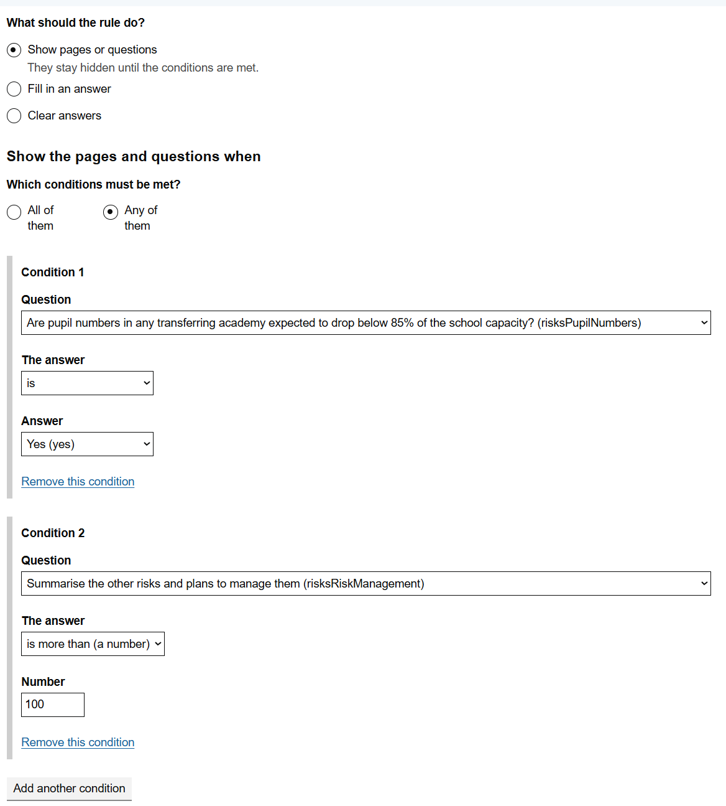

6. Choose what the rule affects:
   - **Show pages or questions**: tick the **Pages to show** and **Questions to show**. **Which task are they in?** starts with the task the first question is in; change it to show pages in another task.
   - **Fill in an answer**: choose the **Question to fill in** and the **Answer to fill in**.
   - **Clear answers**: tick the **Questions to clear**.

   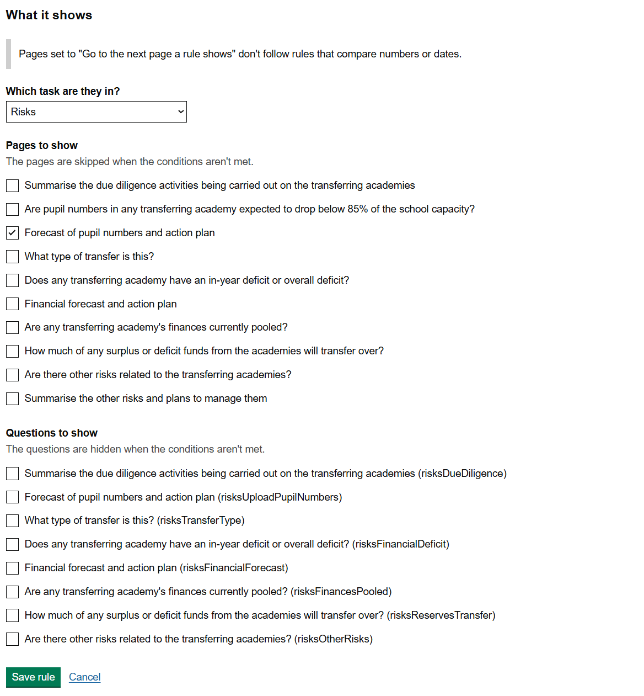

7. Select **Save rule**.

If something is missing, Template Studio tells you what to fix:

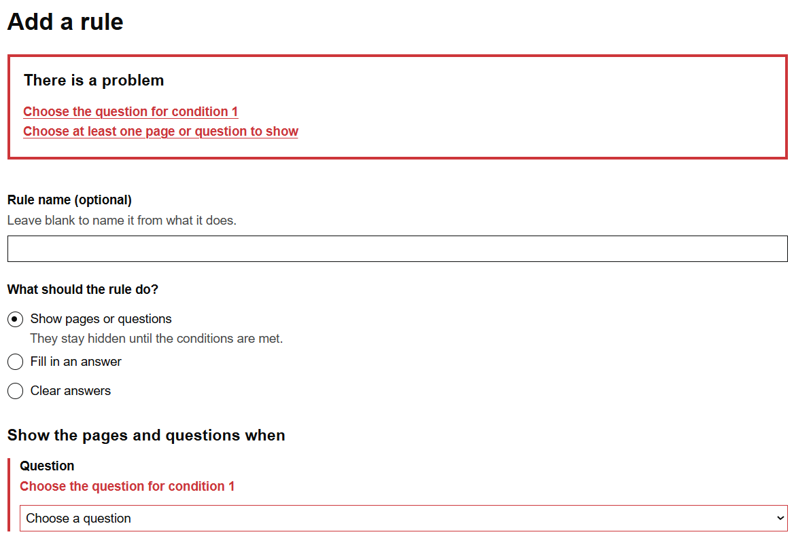

Pages and questions the rule shows get a **Shown by a rule** tag in the structure.

**Comparisons you can use**

| Question type | The answer… |
|---|---|
| Radios and dropdowns | is, is not, is one of, is not one of, has been given, has not been given |
| Checkboxes | includes, does not include, has been given, has not been given |
| Dates | is before, is after, has been given, has not been given |
| Short and long answers, email | is, is not, is more than (a number), is less than (a number), has been given, has not been given |
| Search and upload | has been given, has not been given |

Enter dates as year, month and day, for example 2024-09-30. Numbers can have a decimal point, for example 2.5.

### 12.3 Rules in this template

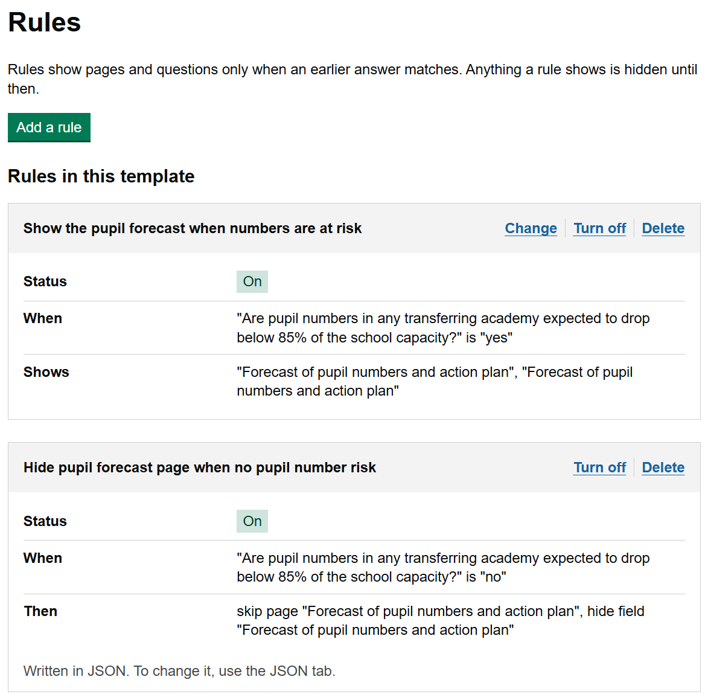

Each rule shows whether it is **On** or **Off**, **When** it applies, and what it **Shows**, **Fills in** or **Clears**.

- **Change**: opens the rule in the rule builder. Only for rules made with the builder. You can change what the rule does, too.
- **Turn off** or **Turn on**: keeps the rule but stops it working. While a rule that shows things is off, the pages and questions it shows are shown to everyone.
- **Delete**: asks you to confirm.

### 12.4 Rules written in JSON

The rule builder opens most rules, including ones written by hand or in older templates, whatever their ids. That includes a rule that shows pages and questions together with the rule that hides the same ones. When you change one of these, it keeps its id, priority and any settings the builder doesn't show.

A rule says "Written in JSON" when the builder can't show it without changing what it does. For example, it uses a comparison the builder doesn't offer, groups conditions inside other conditions, or hides more than its show rule shows. You can turn these rules on or off and delete them here. To change them, use the [JSON tab](#15-the-json-advanced-tab).

Changes you make in the JSON tab, including to rules, appear on the Rules and Design tabs as soon as you leave the JSON tab.

### 12.5 What rules can't do

- Questions inside repeatable lists can't decide a rule, and the builder can't show pages or questions inside lists.
- Whether a question must be answered can't depend on a rule. Show or hide the question instead.
- A rule can't make a question read-only or show a message. The form doesn't act on those settings, so the builder doesn't offer them.

### 12.6 Branching pages

A page set to **Go to the next page a rule shows** branches: applicants go to whichever following page a rule shows. Branching follows rules that compare answers with **is**, **is not**, **is one of**, **is not one of**, **includes**, **has been given** and **has not been given**. It doesn't follow rules that compare numbers or dates; the rule builder reminds you when you use one.

---

## 13. When applications already use the template

Reports line answers up across template versions by answer id and reporting key. Once applications use a template, removing or changing questions carelessly can break reports. Template Studio protects you.

### 13.1 How Template Studio knows

Template Studio checks how many applications use the template, and the applications note under the status says so. If it can't check, it says so and treats the template as in use, to be safe.

### 13.2 Deleting questions applications have answered

When you delete a question, list, page, task or section containing questions applications have answered, the confirmation lists them and explains that they will be **retired**: taken out of the form, but kept in reports.

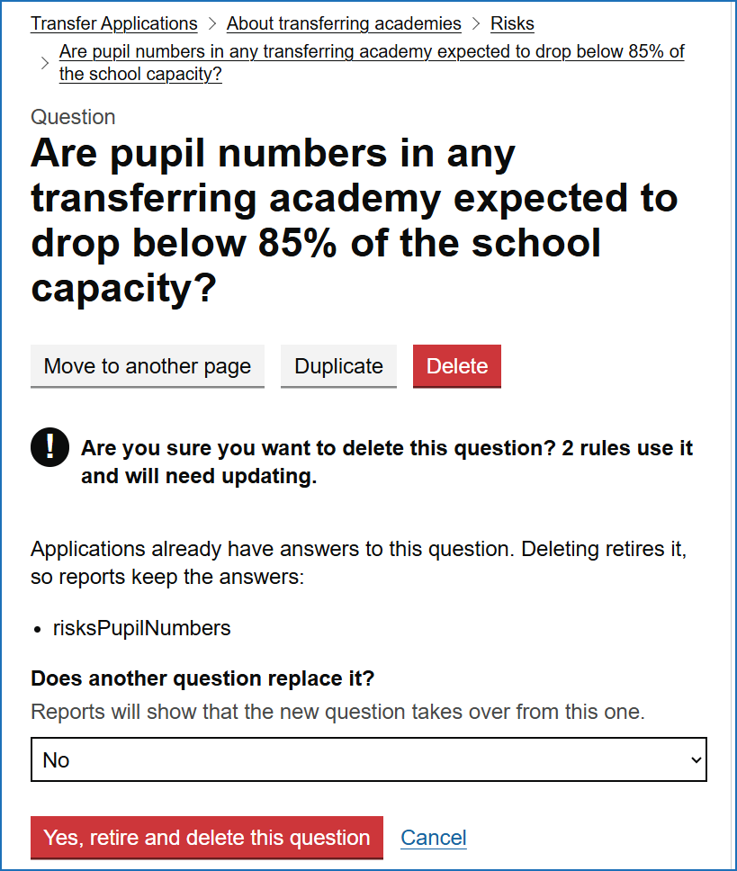

If another question replaces a deleted question, choose it in **Does another question replace it?** so reports show that the new question takes over.

### 13.3 Renaming an answer id

If you change the answer id of a question applications have answered, Template Studio:

- retires the old id;
- names the new id as its replacement;
- keeps the old reporting key on the question, so reports carry on in the same column;
- updates rules to use the new id.

A message under the answer id confirms this. If you change it back, all of that is undone. If an event mapping reads the old id, the message says so; see [13.6](#136-event-mappings).

### 13.4 Changing what a question stores

Changing a question's type to one that stores a different kind of answer (for example from radios to a short answer) needs a new answer id. Template Studio warns you and offers **Give it a new answer id**, which retires the old id for you.

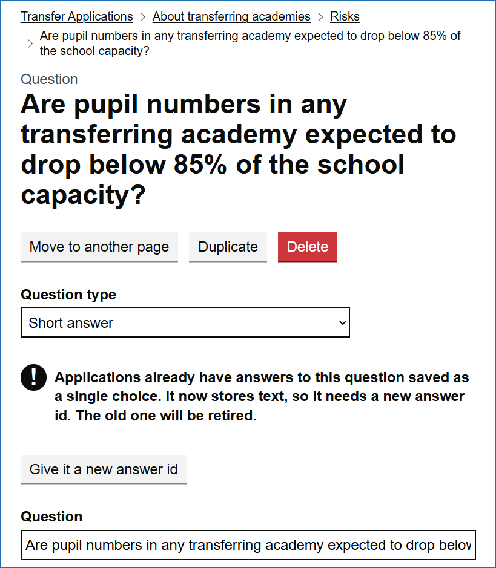

### 13.5 Before you save

**Check for problems** and **Save new version** list anything reports would reject, for example a question removed without being retired. Saving is blocked until they are fixed. These checks compare with the version you opened; saving still checks every earlier version too.

### 13.6 Event mappings

Event mappings (set up on the **Event mappings** admin page) send answers to other services when, for example, an application is submitted. They find answers by answer id, so removing a question or changing its answer id can leave a mapping reading an answer that no longer exists. The event would then be sent without it.

Template Studio warns you:

- **Deleting**: the confirmation lists the answers event mappings read from what you're deleting.
- **Renaming an answer id**: the message under the answer id names the mappings that still read the old id.
- **Saving**: above the save button, a warning lists every answer a mapping reads that isn't in this version. **Check for problems** points you to it.

These warnings don't stop you saving. After you save, update the mappings on the Event mappings page.

---

## 14. Undo and redo

- **Undo** steps back through your changes, and **Redo** steps forward again.
- Every kind of change can be undone: typing, moves, drags, deletes, rules and JSON edits.
- Typing in one box counts as one change. Moving to another box starts a new one.
- Outside text boxes you can press **Ctrl+Z** to undo and **Ctrl+Y** (or **Ctrl+Shift+Z**) to redo. On a Mac use **Cmd**. Inside a text box these keys undo your typing in that box.
- The last 50 changes are kept.
- Undoing everything takes the status back to **No unsaved changes**.

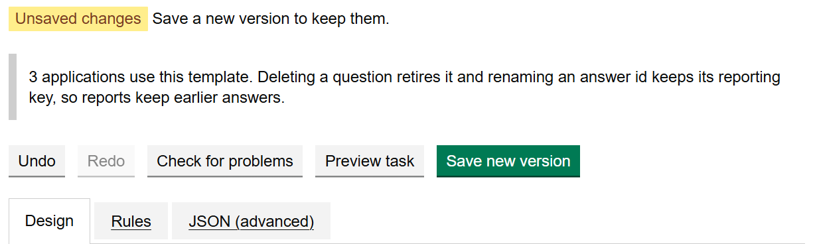

---

## 15. The JSON (advanced) tab

The JSON tab shows the template JSON Template Studio writes. Use it for things Template Studio doesn't have forms for, or to paste in a larger change.

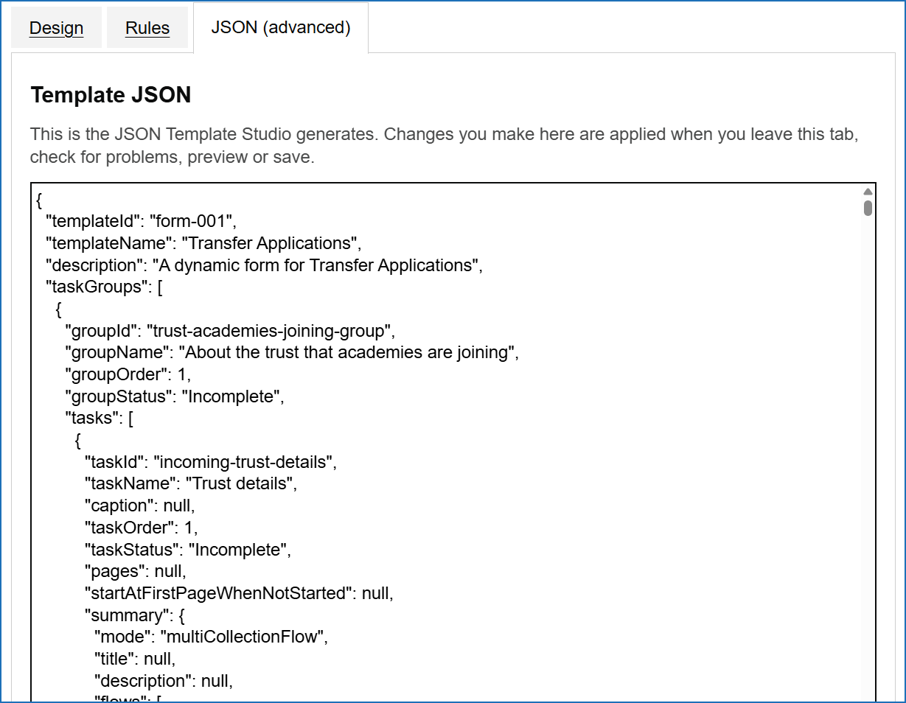

- Your changes are applied when you leave the tab, check for problems, preview or save.
- **Format JSON** tidies the layout.
- If the JSON can't be read, you can't leave the tab until it is fixed. The error message says where to look.

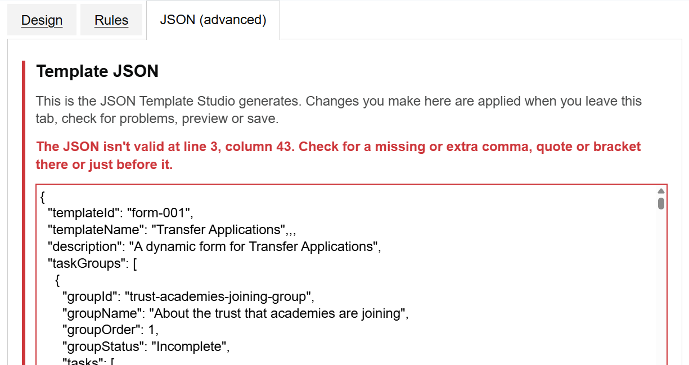

The [Form Template Designer Manual](Form-Template-Designer-Manual.md) explains every part of the JSON.

---

## 16. Checking, previewing and saving

### 16.1 Checking for problems

Select **Check for problems** at any time. It runs the same checks as saving, without saving, and lists anything that would stop the save. That includes missing ids, duplicate ids, questions without options, rules that point at missing questions and reporting problems.

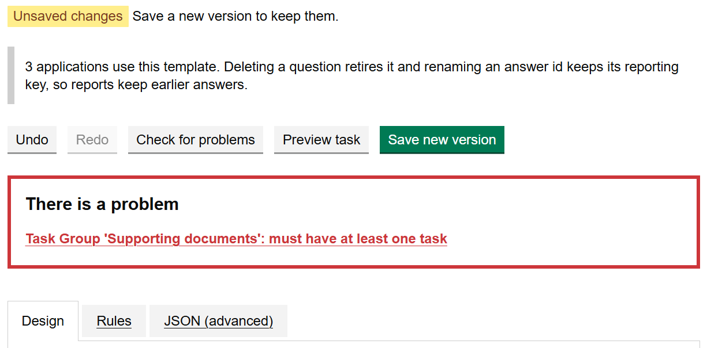

Select a problem to go straight to the item it is about. If there are none, you'll see "No problems found. This template can be saved."

### 16.2 Previewing a task

Select **Preview task** to open your unsaved changes in a new tab and use them as an applicant would. It opens the task you are working on, or the task list if you haven't chosen one.

The preview works like the real form:

- **Answer pages and select Save and continue.** The template's checks run, with its error messages. Rules run as well: pages are skipped and questions hidden or shown according to your answers. Answers are filled in or cleared, and each page's navigation setting is followed.
- **Check your answers.** At the end of a task you see its summary, with **Change** links back to each page.
- **Repeatable lists.** Add, change and remove items, shown as cards or a list with the columns and messages you set. The fewest and most items apply.
- **Repeated pages.** Items come from the answer they repeat for, and each one can be completed.
- **Mark a section as complete.** Choose **Yes, I've completed this section** and select **Continue**. If something is missing, you see the same messages applicants would, for example "Add at least 1 item(s) to Trusts".
- **The task list** shows every task's status. Tasks hidden from applicants' task list are marked.

A few things are different:

- Search and upload questions aren't connected to other services. Type a sample answer instead: the result you'd pick, or the names of the files you'd upload. Lists and repeated pages built from them work with your sample answers.
- Answers are kept only for this preview. Nothing is sent to applications, reports or event mappings. **Clear answers and start again** on the task list empties them.
- The preview ends when you sign out, or after 45 minutes without using it. Select **Preview task** in Template Studio again to start a new one with your latest changes.
- **See every page of … at once** shows all the task's pages on one page, including ones a rule would skip. Pages and questions a rule shows are marked.

### 16.3 Saving a new version

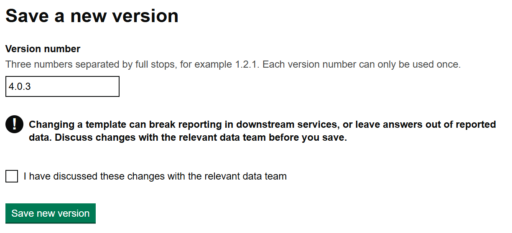

1. Select **Save new version** (or scroll to the bottom of the page).
2. Check the **Version number**. The next number is suggested. It must be three numbers separated by full stops, for example 1.2.1, and each number can only be used once.
3. Read the warning, then tick **I have discussed these changes with the relevant data team**.
4. Select **Save new version**.

If the save is rejected, Template Studio keeps your changes and lists the problems at the top. If it succeeds, you'll see "Version … saved" and can carry on editing.

**If someone else saved while you were working.** Template Studio remembers the latest version when you opened it. If someone saves a newer version before you do, your save stops with "Version … was saved after you opened Template Studio". Your version is based on the copy you opened, so it won't include their changes. Either:

- look at their version in Template Manager and make your changes to it instead; or
- tick **Save my version anyway** and save again, if you're sure their changes can be left out.

Your unsaved changes are kept while you decide.

New applications use the latest saved version. Applications already started keep the version they started on. To make the template available to applicants, make it live on the Admin hub.

---

## 17. Worked examples

### 17.1 Add a yes or no question that reveals a follow-up page

1. In the structure, open the task and select **Edit**.
2. Under **Add a page**, enter "Do you have any concerns?" and select **Add page**.
3. Under **Add a question**, choose **Choose one option (radios)**, leave the question blank to use the page heading, and select **Add question**. It has the options Yes and No.
4. Go back to the task (use the breadcrumbs) and add another page called "Tell us about your concerns", with a **Long answer** question.
5. On that question, select **Add a rule that shows this question**.
6. Leave **Show pages or questions** chosen. Choose "Do you have any concerns?" as the **Question**, **is** as **The answer**, and **Yes**. Also tick the page "Tell us about your concerns". Select **Save rule**.
7. Select **Preview task**. Answer **No** and check the follow-up question isn't on the task's summary. Then select **Change**, answer **Yes**, and check it appears.
8. Select **Check for problems**, then save a new version.

### 17.2 Add a repeatable list of contacts

1. Open the section and, under **Add a task**, choose **A repeatable list**, name it "Contacts", and select **Add task**.
2. Open the list (under the task in the structure, select **Edit**). Set **What is one item called?** to "contact", **What are several items called?** to "contacts" and **Add button text** to "Add a contact".
3. Under **Add a page to each item**, add a page "Contact details" with a **Short answer** question "Full name" and an **Email address** question.
4. Back on the list, set **Answer used as each item's name** to the full name's answer id, and add a column showing the email address.

### 17.3 Rename a question safely

1. Open the question and change its **Answer id**.
2. When you leave the box, read the message under it. If applications use the template, it confirms that the old id is retired and the new one keeps its reporting key.
3. Select **Check for problems**, then save.

### 17.4 Remove a question that is no longer needed

1. Open the question and select **Delete**.
2. If applications have answered it, the warning says it will be retired. If another question replaces it, choose it.
3. Select **Yes, retire and delete this question**.

---

## 18. Keyboard and accessibility tips

- Everything works with a keyboard. Use Tab to move between controls and Enter or Space to select.
- Sections, tasks, lists and pages in the structure open and close with Enter or Space on their name.
- Selecting **Edit** moves focus to the heading of the settings, so screen readers announce what you opened.
- Use **Move up**, **Move down** and **Move to** instead of drag and drop.
- Changes such as moves and undo are announced to screen readers.
- The tabs follow the GOV.UK Design System: use the arrow keys to move between them.

---

## 19. Troubleshooting

| Problem | What to do |
|---|---|
| I can't find Template Studio | Check you can open Template Manager. If you can't, ask an administrator for template Manage permission. |
| Template Studio opened the wrong template | Choose the template in Template Manager first, then open Template Studio. |
| "There was an error loading the template data" | Reload the page. If it keeps happening, the template's latest version may not be readable; check it in Template Manager. |
| I can't leave the JSON tab | The JSON has a mistake. Fix it using the error message, or use **Undo**. |
| A section can't be saved | Every section needs at least one task. |
| A radios question can't be saved | It needs at least one option, and every option needs a saved value. |
| "No search field called … is set up" | Choose another, or ask an administrator to add it in Tenant settings under `FormEngine:ComplexFields`. |
| Save is blocked with reporting problems | Follow the message: usually retire the question rather than deleting it, or give it back its reporting key. See [section 13](#13-when-applications-already-use-the-template). |
| A rule's pages don't appear after a branching page | Branching pages don't follow rules that compare numbers or dates. See [12.6](#126-branching-pages). |
| "Version … was saved after you opened Template Studio" | Someone else saved first. See **If someone else saved while you were working** in [16.3](#163-saving-a-new-version). |
| "Event mappings read answers that aren't in this version" | Update the mappings on the Event mappings page after you save. See [13.6](#136-event-mappings). |
| The preview says "There's nothing to preview" | The preview ended. Select **Preview task** in Template Studio again. |
| A search question in the preview has a text box | The preview doesn't search other services. Type the result you'd pick. |
| A page I didn't expect is hidden | Look for **Shown by a rule** on it, and check the rule on the Rules tab. |
| Version number rejected | Use three numbers, for example 1.2.1, that haven't been used before. |
| I made a mistake | Use **Undo**, or leave without saving to discard all your changes. |

---

## 20. Glossary

| Term | Meaning |
|---|---|
| **Template** | The whole application form: sections, tasks, pages, questions, rules and settings. |
| **Version** | A saved copy of a template. Every save creates a new version; old ones are kept. |
| **Live** | A template applicants can use. Set on the Admin hub. |
| **Section** | A heading on the task list, grouping tasks. |
| **Task** | A row on the task list. |
| **Page** | One screen in the form. |
| **Question** | One thing applicants answer. |
| **Answer id** | What an answer is saved against. Also used by rules and reports. |
| **Reporting key** | What reports use to line answers up across versions. The answer id unless set. |
| **Retired question** | A question taken out of the form whose earlier answers are kept in reports. |
| **Repeatable list** | A task where applicants add as many items as they need. |
| **Repeated pages** | Pages repeated for each item in another list or answer. |
| **Rule** | Shows pages or questions only when an earlier answer matches. |
| **Format check** | Makes sure an answer matches a pattern, such as a postcode. |
| **Search field / upload field** | A question that searches or uploads using a service set up for your organisation. |
